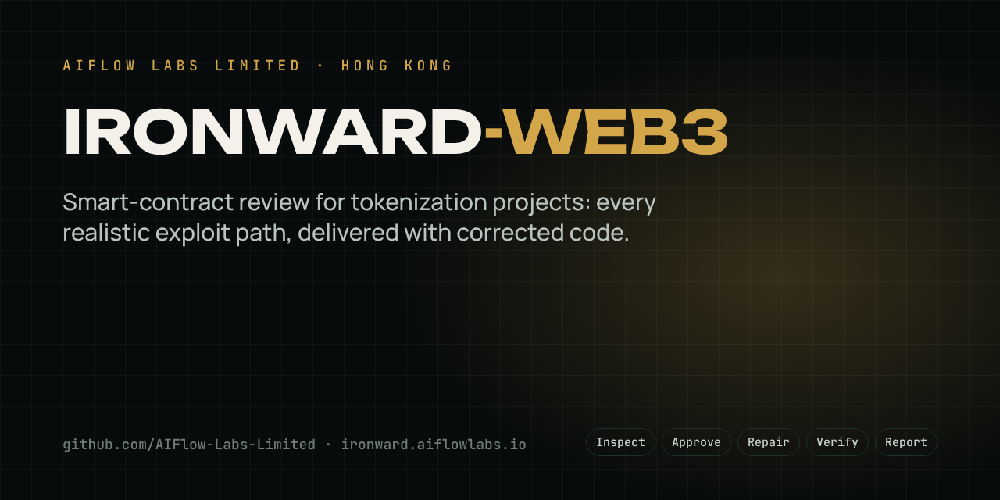

# IRONWARD-WEB3
**Smart-contract review for tokenization projects.**

IRONWARD-WEB3 examines smart contracts for every realistic way they could be exploited, and delivers a report with corrected code.

## What it does
- **Looks for exploit paths**, not just style issues: access control, logic and accounting errors, external-call and upgrade risks, economic attack paths.
- **Delivers fixes.** Every finding comes with evidence, severity and corrected code.
- **Reviewable record.** The full review is recorded in an evidence report the client keeps.
- **For tokenization projects.** We review code; we do not issue or trade tokens.

## Status
In development.

Part of the IRONWARD family → [IRONWARD](https://github.com/AIFlow-Labs-Limited/ironward) · [IRONWARD-WEB](https://github.com/AIFlow-Labs-Limited/ironward-web) · [ironward.aiflowlabs.io](https://ironward.aiflowlabs.io)

---
**AIFLOW LABS LIMITED** · Hong Kong company, registered office in Sheung Wan · Company No. 78586258
[aiflowlabs.io](https://aiflowlabs.io) · ilessio@aiflowlabs.io

This repository holds product information only. The source code is proprietary and not published here.
